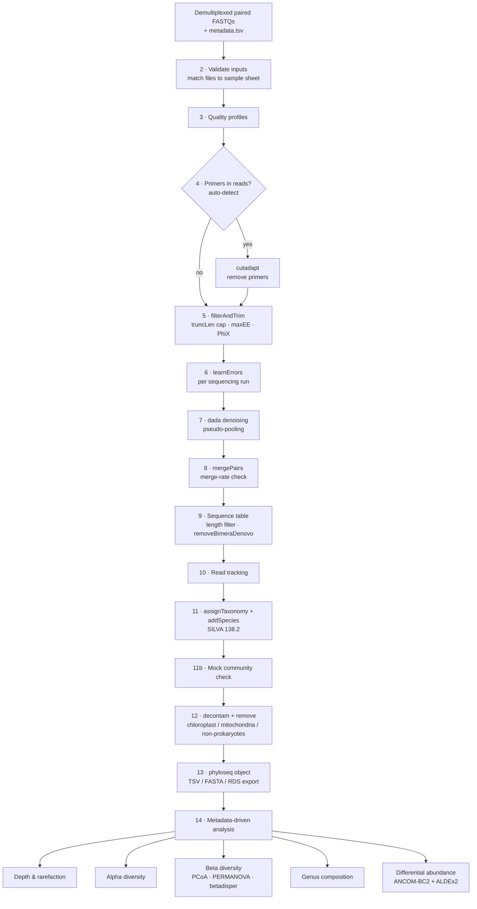

# DADA2 16S rRNA amplicon profiling in Jupyter

A reproducible Jupyter (R kernel) workflow that turns demultiplexed Illumina paired-end 16S rRNA amplicon reads into an annotated amplicon sequence variant (ASV) table and a metadata-driven first-pass statistical analysis.

There are two notebooks. They share the same code and differ only in their region-specific defaults:

| Notebook | Region | Primers (default) | Expected amplicon | Default `trunc_len` / `max_ee` |
|---|---|---|---|---|
| `dada2_16S_V4_workflow.ipynb` | V4 | 515F `GTGYCAGCMGCCGCGGTAA` / 806R `GGACTACNVGGGTWTCTAAT` | 250–256 bp | 240/160 · 2/2 |
| `dada2_16S_V3V4_workflow.ipynb` | V3–V4 | 341F `CCTACGGGNGGCWGCAG` / 805R `GACTACHVGGGTATCTAATCC` | 400–431 bp | 232/220 · 2/5 |

Both notebooks are set up for **Illumina MiSeq 2×250** data from one or more sequencing runs.

> [!WARNING]
> **V3–V4 on 2×250 reads leaves very little overlap.** After primer removal the reads are ~233 bp and ~229 bp, against a ~400–430 bp amplicon. That leaves only ~20–60 bp of overlap, so low-quality read ends can barely be truncated. The V3–V4 notebook checks the expected overlap, reports the merge rate, and offers a `forward_only` fallback mode. V3–V4 is normally sequenced 2×300.

---

## Contents

- [Repository layout](#repository-layout)
- [Workflow overview](#workflow-overview)
- [Design decisions](#design-decisions)
- [Installation](#installation)
- [Input data](#input-data)
- [Running the workflow](#running-the-workflow)
- [Parameters](#parameters)
- [Outputs](#outputs)
- [Testing](#testing)
- [Troubleshooting](#troubleshooting)
- [Limitations](#limitations)
- [References](#references)

---

## Repository layout

```
.
├── dada2_16S_V4_workflow.ipynb     # V4 notebook
├── dada2_16S_V3V4_workflow.ipynb   # V3–V4 notebook
├── environment.yml                 # conda environment with compatibility pins
├── metadata_template.tsv           # example sample sheet
├── data/                           # (not tracked) raw FASTQs + metadata.tsv
│   ├── raw_seq/
│   └── metadata.tsv
├── refs/                           # (not tracked) SILVA training files
└── results/                        # (generated) all outputs and cache
```

Suggested `.gitignore`:

```gitignore
data/
refs/
results/
.ipynb_checkpoints/
```

---

## Workflow overview



| § | Step | Main tools | Key output |
|---|---|---|---|
| 0 | Project parameters | — | `params` list |
| 1 | Environment and versions | — | package versions |
| 2 | Inputs and sample sheet | base R | validated `meta` |
| 3 | Raw read QC | `dada2::plotQualityProfile` | quality plots |
| 4 | Primer detection and removal | ShortRead, Biostrings, cutadapt | primer-free reads |
| 5 | Filter and trim | `dada2::filterAndTrim` | filtered FASTQs |
| 6 | Error model (per run) | `dada2::learnErrors` | error models |
| 7–8 | Denoise and merge | `dada2::dada`, `mergePairs` | per-run sequence tables |
| 9 | ASV table and chimera removal | `makeSequenceTable`, `removeBimeraDenovo` | `seqtab.nochim` |
| 10 | Read tracking | dplyr, ggplot2 | `read_tracking.tsv` |
| 11 | Taxonomy | `assignTaxonomy`, `addSpecies` + SILVA 138.2 | taxonomy table |
| 11b | Mock community check | Biostrings | ASV-vs-reference match summary |
| 12 | Contaminants and off-target taxa | decontam | cleaned ASV table |
| 13 | Export | phyloseq | `asv_*.tsv`, `asv_seqs.fasta`, `phyloseq.rds` |
| 14 | Downstream analysis | phyloseq, vegan, ANCOMBC, ALDEx2 | `results/downstream/*` |
| 15 | Session record | — | `sessionInfo.txt` |

---

## Design decisions

**Exact sequence variants, not OTUs.** DADA2 infers biological sequences exactly, using a run-specific error model. ASVs are reproducible across studies and need no similarity threshold [1, 2].

**R kernel in Jupyter.** DADA2, phyloseq, decontam, ANCOM-BC2 and ALDEx2 are all R/Bioconductor packages. Running them natively through IRkernel avoids a Python–R bridge.

**One parameter cell.** Every tunable value lives in section 0, so changing an analysis means editing one cell rather than code spread across the notebook.

**Caching tied to settings.** The slow steps (filtering, error learning, denoising, chimera removal, taxonomy) are saved to `results/cache/`. Each cache file name includes a fingerprint of the input files and of every parameter that affects that step or any step before it. Changing a setting re-runs exactly the affected steps, and a result from an earlier run is never reused by mistake.

**Primer handling that works with any library prep.** Some protocols put the gene primers in the reads; others use them as sequencing primers, so the reads start right after them. Section 4 counts primer hits in the first 2,000 reads of several samples. If at least 50% of reads contain the forward primer, cutadapt [3] removes both primers and discards pairs without them. Otherwise the reads are passed on unchanged. Primers aren't anchored, so heterogeneity spacers are tolerated. You can override the detection with `primers_in_reads = TRUE/FALSE`.

**Truncation guards.** `filterAndTrim` silently discards reads shorter than `truncLen`. The notebook therefore measures the actual read length (5th percentile) after primer removal and caps `trunc_len` at it. It also checks that the truncated reads still overlap by at least `min_overlap` (12 bp), and warns below 20 bp.

**Error models per run.** Each sequencing run has its own error profile, so `learnErrors` is run separately for each `run_id` and the per-run tables are merged afterwards [1].

**Pseudo-pooling.** `pool = "pseudo"` recovers rare variants that appear in several samples, at much lower cost than full pooling [1].

**Contaminant screening that fits the controls available.** decontam's prevalence method is used when negative controls are present [8]. With few controls it has limited power, so the default threshold is raised to 0.5, and every ASV seen in a control is listed for manual review. If a DNA-concentration column is supplied (`dna_conc_col`), the frequency method is added (`method = "either"`). Chloroplast, mitochondrial and non-Bacteria/Archaea ASVs are removed.

**Compositionally aware statistics.**
- Beta diversity uses the Aitchison distance (Euclidean distance on CLR-transformed, unrarefied counts) [16], alongside Bray–Curtis on a rarefied table for comparison with the literature.
- Rarefied counts are used only for richness metrics and Bray–Curtis, following the concerns raised about rarefying [15].
- PERMANOVA [12] is always reported together with a test for differences in spread (`betadisper`) [13], because PERMANOVA can be significant from spread differences alone.
- Differential abundance is run with two methods of different design, ANCOM-BC2 [10] and ALDEx2 [11]. Only genera called by both are reported as the consensus.

**Downstream analysis driven by metadata.** Section 14 contains no study-specific code. It detects study variables in `metadata.tsv`:
- **Categorical:** character or logical columns with 2–10 levels, plus integer columns with 2–5 values, such as a timepoint coded 1/2/3.
- **Numeric:** columns with more than 5 distinct values.
- **Ignored:** ID-like columns, where every value is unique.

Each variable is analysed on its own. If no variables are found, only the descriptive parts run. You can override the detection with `group_vars` / `num_vars`.

**Fail early with a specific message.** The notebook stops with a message saying what to fix in each of these cases: no FASTQs match the file pattern, file names and sample IDs don't match, sample IDs are duplicated, no reads pass filtering, or no ASVs fall in the expected length range.

---

## Installation

### 1. Install a conda distribution

If neither `mamba` nor `conda` is available, install [Miniforge](https://github.com/conda-forge/miniforge), which provides both:

```bash
# macOS / Linux
curl -L -O "https://github.com/conda-forge/miniforge/releases/latest/download/Miniforge3-$(uname)-$(uname -m).sh"
bash Miniforge3-$(uname)-$(uname -m).sh       # answer "yes" to initialise your shell, then reopen the terminal
```

On macOS with Homebrew you can instead run `brew install miniforge && conda init zsh`.

### 2. Create the environment

```bash
git clone <this-repo-url>
cd <this-repo>
mamba env create -f environment.yml          # or: conda env create -f environment.yml
conda activate dada2-16s
```

`environment.yml` installs R 4.4, JupyterLab, IRkernel, dada2, phyloseq, decontam, ANCOMBC, ALDEx2, vegan, tidyverse and cutadapt from conda-forge and bioconda [21]. It also pins several packages to avoid known incompatibilities:

| Pin | Why |
|---|---|
| `tbb=2020.2` | Newer TBB builds make dada2 fail to load (`undefined symbol: _ZTIN3tbb4taskE`) |
| `r-cvxr<1.9` | ANCOMBC 2.8 imports `CVXR::solve`, which was removed in CVXR 1.9 |
| `r-lme4>=1.1.36`, `r-reformulas` | Without them, the CVXR pin pulls in an lme4 built against an older Matrix ABI |

The environment has been resolved for linux-64, osx-64 and osx-arm64. The versions resolved and tested were:

| Package | Version |
|---|---|
| R | 4.4.3 |
| dada2 | 1.34.0 |
| phyloseq | 1.50.0 |
| decontam | 1.26.0 |
| ANCOMBC | 2.8.0 |
| ALDEx2 | 1.38.0 |
| cutadapt | 5.2 |

### 3. Register the Jupyter kernel

```bash
R -e 'IRkernel::installspec(name = "dada2-16s", displayname = "R (dada2-16s)")'
jupyter lab
```

Open a notebook and select the **R (dada2-16s)** kernel.

### 4. Download the reference database

Download the DADA2-formatted SILVA 138.2 files [6] from Zenodo record [14169026](https://zenodo.org/records/14169026) into `refs/`:

| File | Used by | Notebook parameter |
|---|---|---|
| `silva_nr99_v138.2_toGenus_trainset.fa.gz` | `assignTaxonomy` (Kingdom → Genus) | `silva_train` |
| `silva_v138.2_assignSpecies.fa.gz` | `addSpecies` (exact matching) | `silva_species` |

Other DADA2-formatted databases (RDP, GTDB, GreenGenes2) are listed on the [DADA2 training-data page](https://benjjneb.github.io/dada2/training.html). Any of them can be used by changing `silva_train` / `silva_species`.

---

## Input data

### FASTQ files

The workflow expects demultiplexed, per-sample paired-end files, either uncompressed or gzipped. By default it matches names like these:

```
F3D0_S188_L001_R1_001.fastq     F3D0_S188_L001_R2_001.fastq
S01_R1.fastq.gz                 S01_R2.fastq.gz
```

The sample ID is the file name with `sample_id_regex` removed. The default, `"_.*$"`, keeps the text before the first underscore, so `F3D0_S188_L001_R1_001.fastq` becomes `F3D0`. If your sample names contain underscores, adjust `sample_id_regex`.

### Sample sheet (`data/metadata.tsv`)

The sample sheet is tab-separated, with one row per sample. See `metadata_template.tsv`.

| Column | Required | Values |
|---|---|---|
| `sample_id` | yes | sample ID as derived from the file name |
| `run_id` | yes | sequencing run; the same value for every sample from a single run |
| `sample_type` | yes | `sample`, `neg_control`, or `mock` |
| *any other column* | no | study variables such as treatment, timepoint, site or age; used automatically in section 14 |

---

## Running the workflow

1. Copy FASTQs to `data/raw_seq/` and create `data/metadata.tsv`.
2. Open the notebook for your amplicon region and edit **section 0**. At minimum check `raw_dir`, the primers and, after looking at the plots in section 3, `trunc_len`.
3. Run the notebook top to bottom (**Run → Run All Cells**).
4. Check the diagnostics before interpreting results:

| Check | Where | What to look for |
|---|---|---|
| Primer detection | §4 | Primer hits near 0 after cutadapt; for primer-free libraries, ~0% detected and cutadapt skipped |
| Fraction of reads kept after filtering | §5 | Usually above 70% |
| Error model fit | §6 | The fitted (black) line follows the observed points |
| Merge rate | §8 | V4: above 90%. V3–V4 on 2×250: often lower; below 50% consider `mode = "forward_only"` |
| ASV length distribution | §9 | V4: 252–254 bp. V3–V4: 400–430 bp |
| Fraction of reads that are chimeras | §9 | Under ~15–20%; more suggests primers were left on the reads |
| Mock community | §11b | ASV count close to the number of strains; most reads match a reference strain |
| Negative control | §12 | Review the list of ASVs found in the control |

### Trial dataset

The V4 notebook runs unchanged on the [mothur MiSeq SOP data](https://mothur.org/wiki/miseq_sop/) [19], which is also used in the official DADA2 tutorial: 19 mouse gut samples plus a 20-strain mock community, sequenced 2×250. Its reads contain no primers, and section 4 detects this automatically. To check the mock community against its known composition, set `mock_ref = "data/raw_seq/HMP_MOCK.v35.fasta"`.

---

## Parameters

All parameters are in the `params` list in section 0.

| Parameter | V4 default | V3–V4 default | Description |
|---|---|---|---|
| `raw_dir` | `data/raw_seq` | `data/raw_seq` | Folder containing the FASTQs |
| `metadata` | `data/metadata.tsv` | same | Sample sheet |
| `fwd_pattern` / `rev_pattern` | `_R1(_001)?\.f(ast)?q(\.gz)?$` | same | Regexes identifying R1/R2 files |
| `sample_id_regex` | `_.*$` | same | Removed from the file name to give the sample ID |
| `primer_fwd` / `primer_rev` | 515F / 806R | 341F / 805R | Primer sequences (IUPAC codes allowed) |
| `primers_in_reads` | `NA` | `NA` | `NA` = auto-detect; `TRUE` / `FALSE` = force |
| `amplicon_len` | `c(250, 256)` | `c(400, 431)` | Accepted merged ASV length range |
| `mode` | `"paired"` | `"paired"` | `"forward_only"` builds ASVs from R1 only |
| `trunc_len` | `c(240, 160)` | `c(232, 220)` | Truncation positions (capped at the actual read length) |
| `max_ee` | `c(2, 2)` | `c(2, 5)` | Maximum expected errors per read |
| `trunc_q` | `2` | `2` | Truncate at the first base with quality ≤ this value |
| `min_overlap` | `12` | `12` | Minimum overlap for `mergePairs` |
| `min_merge_rate` | `0.5` | `0.5` | Warn if the median merge rate falls below this |
| `pool` | `"pseudo"` | `"pseudo"` | `FALSE`, `"pseudo"` or `TRUE` |
| `silva_train` / `silva_species` | SILVA 138.2 | same | Reference training files |
| `mock_ref` | `NULL` | `NULL` | FASTA of the mock community's true sequences |
| `decontam_threshold` | `0.5` | `0.5` | decontam score threshold |
| `dna_conc_col` | `NULL` | `NULL` | Metadata column with DNA concentration; enables the frequency method |
| `group_vars` / `num_vars` | `NULL` | `NULL` | `NULL` = auto-detect study variables |
| `min_depth` | `5000` | `5000` | Samples with fewer reads are excluded from section 14 |
| `alpha_level` | `0.05` | `0.05` | Significance threshold for differential abundance |
| `threads` | `TRUE` | `TRUE` | Use all cores for DADA2 |
| `seed` | `100` | `100` | Random seed |

---

## Outputs

All outputs are written to `results/`:

| File | Contents |
|---|---|
| `asv_counts.tsv` | `ASV_ID` plus one read-count column per sample, including controls and mock |
| `asv_taxonomy.tsv` | `ASV_ID`, Kingdom … Species (blank where unassigned) |
| `asv_report.tsv` | Taxonomy, sequence, length, total reads, % of reads, number of samples detected in, and per-sample counts, sorted by abundance |
| `asv_seqs.fasta` | ASV sequences, named `ASV1`, `ASV2`, … |
| `phyloseq_with_controls.rds` | phyloseq object including controls and mock |
| `phyloseq.rds` | phyloseq object with biological samples only, as used in section 14 |
| `read_tracking.tsv` | Reads per sample at each step |
| `sessionInfo.txt` | R and package versions |
| `cutadapt/<primer-hash>/` | Primer-trimmed reads and cutadapt logs |
| `filtered/` | Filtered reads |
| `cache/` | Saved intermediate results (safe to delete) |

`results/downstream/`:

| File | Contents |
|---|---|
| `alpha_diversity.tsv` | Observed ASVs and Shannon index per sample, with metadata |
| `alpha_tests.tsv` | Wilcoxon / Kruskal–Wallis / Spearman tests, BH-adjusted [17] |
| `permanova.tsv` | R², p-value, BH-adjusted p and dispersion p for each variable × distance |
| `genus_composition_top.tsv` | Relative abundance of the top 12 genera per sample |
| `DA_<variable>.tsv` | ANCOM-BC2 log fold changes and q-values (Holm [18]), ALDEx2 effect sizes and q-values, and the consensus call |

Plots (quality profiles, error models, read tracking, depth histogram, rarefaction curves, alpha-diversity boxplots, PCoA, composition bars) are shown inline in the notebook.

---

## Testing

Both notebooks were run end to end on simulated MiSeq 2×250 datasets. In all three, every simulated variant was recovered exactly, at the expected length:

| Simulated dataset | Additional checks |
|---|---|
| V4, no primers (mothur SOP style, uncompressed), mock community, no negative control | cutadapt correctly skipped; mock ASVs matched the reference strains 8/8 |
| V4 with primers, gzipped | both primers detected and removed; `trunc_len` capped at the trimmed read length |
| V3–V4 with primers and a negative control | expected overlap of 21 bp; planted kit contaminants flagged by decontam |

Section 14 was also tested on a simulated 95-sample dataset with planted effects. ANCOM-BC2 and ALDEx2 agreed on genera for the variables with an effect, and called nothing for a variable without one.

A further test ran a broken configuration, then a corrected one in the same folder, to confirm that saved results from the broken run were not reused. Real data should still be checked against the diagnostics listed under [Running the workflow](#running-the-workflow).

---

## Troubleshooting

| Symptom | Cause | Fix |
|---|---|---|
| `zsh: command not found: mamba` | No conda distribution installed | Install Miniforge (see [Installation](#1-install-a-conda-distribution)) |
| `undefined symbol: _ZTIN3tbb4taskE` when loading dada2 | Incompatible TBB | Make sure `tbb=2020.2` is in the environment |
| `could not find function "solve"` / ANCOMBC fails to load | CVXR ≥ 1.9 | `mamba install -n dada2-16s "r-cvxr<1.9" "r-lme4>=1.1.36" r-reformulas` |
| `No R1 files matching fwd_pattern` | Wrong `raw_dir` or unexpected file names | The error lists the files it found; adjust `raw_dir` / `fwd_pattern` |
| `FASTQs without metadata: …` | Sample IDs from file names don't match `metadata.tsv` | Adjust `sample_id_regex` or the `sample_id` column |
| `No reads passed filtering` | `trunc_len` longer than the reads, `max_ee` too strict, or primers were expected but are absent | Check §3 plots and the §4 primer-detection output |
| Low merge rate (V3–V4) | Too little overlap with 2×250 reads | Raise `max_ee[2]`, change `trunc_len`, or set `mode = "forward_only"` |
| `No ASVs in the expected length range` | Wrong `amplicon_len` or wrong primer setting | Compare with the length table printed in §9 |

---

## Limitations

- **Single-variable analyses only.** Section 14 tests each variable on its own. Covariates, repeated measures (for example subject as a random effect) and interactions must be added once the study design is fixed. ANCOM-BC2 supports these through `fix_formula` and `rand_formula` [10], and vegan through the `adonis2` formula and `strata`.
- **Exact species matching.** `addSpecies` assigns a species only when the ASV matches the reference exactly, so species calls are conservative and often missing. It is skipped in `forward_only` mode.
- **Few negative controls.** With one or two controls, decontam has limited power. Review the list of ASVs in the controls.
- **No phylogenetic tree.** UniFrac and Faith's PD therefore aren't computed. A tree can be added with DECIPHER and phangorn, or with FastTree.
- **No functional prediction.** Tools like PICRUSt2 aren't included.

---

## References

### Core method

- **[1]** Callahan BJ, McMurdie PJ, Rosen MJ, Han AW, Johnson AJA, Holmes SP. DADA2: High-resolution sample inference from Illumina amplicon data. *Nat Methods*. 2016;13(7):581–583. [doi:10.1038/nmeth.3869](https://doi.org/10.1038/nmeth.3869)
- **[2]** Callahan BJ, McMurdie PJ, Holmes SP. Exact sequence variants should replace operational taxonomic units in marker-gene data analysis. *ISME J*. 2017;11(12):2639–2643. [doi:10.1038/ismej.2017.119](https://doi.org/10.1038/ismej.2017.119)
- **[3]** Martin M. Cutadapt removes adapter sequences from high-throughput sequencing reads. *EMBnet.journal*. 2011;17(1):10–12. [doi:10.14806/ej.17.1.200](https://doi.org/10.14806/ej.17.1.200)
- **[4]** Callahan BJ, Sankaran K, Fukuyama JA, McMurdie PJ, Holmes SP. Bioconductor workflow for microbiome data analysis: from raw reads to community analyses. *F1000Research*. 2016;5:1492. [doi:10.12688/f1000research.8986.2](https://doi.org/10.12688/f1000research.8986.2)

### Taxonomy and reference databases

- **[5]** Wang Q, Garrity GM, Tiedje JM, Cole JR. Naïve Bayesian classifier for rapid assignment of rRNA sequences into the new bacterial taxonomy. *Appl Environ Microbiol*. 2007;73(16):5261–5267. [doi:10.1128/AEM.00062-07](https://doi.org/10.1128/AEM.00062-07). This is the algorithm implemented by `assignTaxonomy`.
- **[6]** Callahan BJ. Silva taxonomic training data formatted for DADA2 (Silva version 138.2). Zenodo; 2024. [doi:10.5281/zenodo.14169026](https://doi.org/10.5281/zenodo.14169026)
- **[7]** Quast C, Pruesse E, Yilmaz P, Gerken J, Schweer T, Yarza P, Peplies J, Glöckner FO. The SILVA ribosomal RNA gene database project: improved data processing and web-based tools. *Nucleic Acids Res*. 2013;41(D1):D590–D596. [doi:10.1093/nar/gks1219](https://doi.org/10.1093/nar/gks1219)
  - Yilmaz P, Parfrey LW, Yarza P, Gerken J, Pruesse E, Quast C, Schweer T, Peplies J, Ludwig W, Glöckner FO. The SILVA and "All-species Living Tree Project (LTP)" taxonomic frameworks. *Nucleic Acids Res*. 2014;42(D1):D643–D648. [doi:10.1093/nar/gkt1209](https://doi.org/10.1093/nar/gkt1209)

The SILVA data are licensed under CC BY 4.0. If you use the SILVA training files, cite the SILVA papers, the DADA2 paper and the Zenodo record.

### Contamination, data structures and statistics

- **[8]** Davis NM, Proctor DM, Holmes SP, Relman DA, Callahan BJ. Simple statistical identification and removal of contaminant sequences in marker-gene and metagenomics data. *Microbiome*. 2018;6:226. [doi:10.1186/s40168-018-0605-2](https://doi.org/10.1186/s40168-018-0605-2) (decontam)
- **[9]** McMurdie PJ, Holmes S. phyloseq: an R package for reproducible interactive analysis and graphics of microbiome census data. *PLoS ONE*. 2013;8(4):e61217. [doi:10.1371/journal.pone.0061217](https://doi.org/10.1371/journal.pone.0061217)
- **[10]** Lin H, Peddada SD. Multigroup analysis of compositions of microbiomes with covariate adjustments and repeated measures. *Nat Methods*. 2024;21(1):83–91. [doi:10.1038/s41592-023-02092-7](https://doi.org/10.1038/s41592-023-02092-7) (ANCOM-BC2)
  - Lin H, Peddada SD. Analysis of compositions of microbiomes with bias correction. *Nat Commun*. 2020;11:3514. [doi:10.1038/s41467-020-17041-7](https://doi.org/10.1038/s41467-020-17041-7) (ANCOM-BC)
- **[11]** Fernandes AD, Reid JNS, Macklaim JM, McMurrough TA, Edgell DR, Gloor GB. Unifying the analysis of high-throughput sequencing datasets: characterizing RNA-seq, 16S rRNA gene sequencing and selective growth experiments by compositional data analysis. *Microbiome*. 2014;2:15. [doi:10.1186/2049-2618-2-15](https://doi.org/10.1186/2049-2618-2-15) (ALDEx2)
- **[12]** Anderson MJ. A new method for non-parametric multivariate analysis of variance. *Austral Ecol*. 2001;26(1):32–46. [doi:10.1111/j.1442-9993.2001.01070.pp.x](https://doi.org/10.1111/j.1442-9993.2001.01070.pp.x) (PERMANOVA)
- **[13]** Anderson MJ. Distance-based tests for homogeneity of multivariate dispersions. *Biometrics*. 2006;62(1):245–253. [doi:10.1111/j.1541-0420.2005.00440.x](https://doi.org/10.1111/j.1541-0420.2005.00440.x) (`betadisper`)
- **[14]** Oksanen J, Simpson GL, Blanchet FG, et al. vegan: Community Ecology Package. R package. [CRAN](https://CRAN.R-project.org/package=vegan)
- **[15]** McMurdie PJ, Holmes S. Waste not, want not: why rarefying microbiome data is inadmissible. *PLoS Comput Biol*. 2014;10(4):e1003531. [doi:10.1371/journal.pcbi.1003531](https://doi.org/10.1371/journal.pcbi.1003531)
- **[16]** Gloor GB, Macklaim JM, Pawlowsky-Glahn V, Egozcue JJ. Microbiome datasets are compositional: and this is not optional. *Front Microbiol*. 2017;8:2224. [doi:10.3389/fmicb.2017.02224](https://doi.org/10.3389/fmicb.2017.02224) (CLR / Aitchison distance)
- **[17]** Benjamini Y, Hochberg Y. Controlling the false discovery rate: a practical and powerful approach to multiple testing. *J R Stat Soc Series B*. 1995;57(1):289–300. [doi:10.1111/j.2517-6161.1995.tb02031.x](https://doi.org/10.1111/j.2517-6161.1995.tb02031.x)
- **[18]** Holm S. A simple sequentially rejective multiple test procedure. *Scand J Stat*. 1979;6(2):65–70.

### Primers and test data

- **341F / 805R:** Klindworth A, Pruesse E, Schweer T, Peplies J, Quast C, Horn M, Glöckner FO. Evaluation of general 16S ribosomal RNA gene PCR primers for classical and next-generation sequencing-based diversity studies. *Nucleic Acids Res*. 2013;41(1):e1. [doi:10.1093/nar/gks808](https://doi.org/10.1093/nar/gks808)
  - Herlemann DPR, Labrenz M, Jürgens K, Bertilsson S, Waniek JJ, Andersson AF. Transitions in bacterial communities along the 2000 km salinity gradient of the Baltic Sea. *ISME J*. 2011;5(10):1571–1579. [doi:10.1038/ismej.2011.41](https://doi.org/10.1038/ismej.2011.41)
- **515F (Parada):** Parada AE, Needham DM, Fuhrman JA. Every base matters: assessing small subunit rRNA primers for marine microbiomes with mock communities, time series and global field samples. *Environ Microbiol*. 2016;18(5):1403–1414. [doi:10.1111/1462-2920.13023](https://doi.org/10.1111/1462-2920.13023)
- **806R (Apprill):** Apprill A, McNally S, Parsons R, Weber L. Minor revision to V4 region SSU rRNA 806R gene primer greatly increases detection of SAR11 bacterioplankton. *Aquat Microb Ecol*. 2015;75(2):129–137. [doi:10.3354/ame01753](https://doi.org/10.3354/ame01753)
- **Test dataset:**
  - **[19]** Kozich JJ, Westcott SL, Baxter NT, Highlander SK, Schloss PD. Development of a dual-index sequencing strategy and curation pipeline for analyzing amplicon sequence data on the MiSeq Illumina sequencing platform. *Appl Environ Microbiol*. 2013;79(17):5112–5120. [doi:10.1128/AEM.01043-13](https://doi.org/10.1128/AEM.01043-13)
  - Schloss PD, Westcott SL, Ryabin T, et al. Introducing mothur: open-source, platform-independent, community-supported software for describing and comparing microbial communities. *Appl Environ Microbiol*. 2009;75(23):7537–7541. [doi:10.1128/AEM.01541-09](https://doi.org/10.1128/AEM.01541-09)

### Software infrastructure

- **[20]** Huber W, Carey VJ, Gentleman R, et al. Orchestrating high-throughput genomic analysis with Bioconductor. *Nat Methods*. 2015;12(2):115–121. [doi:10.1038/nmeth.3252](https://doi.org/10.1038/nmeth.3252)
- **[21]** Grüning B, Dale R, Sjödin A, et al. Bioconda: sustainable and comprehensive software distribution for the life sciences. *Nat Methods*. 2018;15(7):475–476. [doi:10.1038/s41592-018-0046-7](https://doi.org/10.1038/s41592-018-0046-7)
- **[22]** Morgan M, Anders S, Lawrence M, Aboyoun P, Pagès H, Gentleman R. ShortRead: a Bioconductor package for input, quality assessment and exploration of high-throughput sequence data. *Bioinformatics*. 2009;25(19):2607–2608. [doi:10.1093/bioinformatics/btp450](https://doi.org/10.1093/bioinformatics/btp450)
- **[23]** Pagès H, Aboyoun P, Gentleman R, DebRoy S. Biostrings: efficient manipulation of biological strings. R/Bioconductor package. [Bioconductor](https://bioconductor.org/packages/Biostrings)
- **[24]** Wickham H, Averick M, Bryan J, et al. Welcome to the tidyverse. *J Open Source Softw*. 2019;4(43):1686. [doi:10.21105/joss.01686](https://doi.org/10.21105/joss.01686)
- **[25]** Kluyver T, Ragan-Kelley B, Pérez F, et al. Jupyter Notebooks – a publishing format for reproducible computational workflows. In: *Positioning and Power in Academic Publishing: Players, Agents and Agendas*. IOS Press; 2016:87–90. [doi:10.3233/978-1-61499-649-1-87](https://doi.org/10.3233/978-1-61499-649-1-87)
- **[26]** IRkernel: R kernel for Jupyter. [github.com/IRkernel/IRkernel](https://github.com/IRkernel/IRkernel)

### Suggested methods text

> Demultiplexed paired-end reads were processed in R with DADA2 [1], using the workflow in this repository (commit `<hash>`). Primers were removed with cutadapt [3]. Reads were filtered (`truncLen` = …, `maxEE` = …), error models were learned separately for each sequencing run, and ASVs were inferred with pseudo-pooling. Read pairs were merged, and chimeras were removed with the consensus method. Taxonomy was assigned with the naïve Bayesian classifier [5] against SILVA 138.2 [6, 7], and species were assigned by exact matching. Contaminants were identified with decontam [8], and chloroplast, mitochondrial and non-prokaryotic ASVs were removed. Diversity analyses used phyloseq [9] and vegan [14]. Differential abundance was assessed with ANCOM-BC2 [10] and ALDEx2 [11], and genera significant in both are reported.

---

## License

MIT License. The SILVA reference data are distributed separately under CC BY 4.0.
